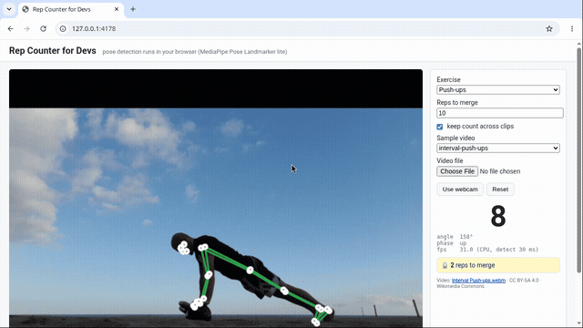

# squat-to-merge

**No push-ups, no merge.** A joke GitHub Action. A pull request can't go green until its
description or a comment has a rep token from the in-browser Rep Counter, showing at least 10 squats or push-ups.

## This is a joke, and tokens are forgeable
- The token is `REPS-<base64(exercise:reps:time)>-<sha256(payload + ":sweat-equity")[0:12]>`.
  The salt is in this repo, so anyone can mint a token without moving. It's an honour system with extra steps.
- Tokens expire after 24 h, but they can be reused within that window and on any PR.
- The counter doesn't check *who* is exercising. Above, it's counting a person in a Wikimedia Commons video.
- Don't use this as a real merge gate.

## How it works
1. Open the Rep Counter (`npm i && npm run dev`), choose a clip or a webcam, and do 10 reps. Pose detection runs
   locally (MediaPipe Pose Landmarker lite, no uploads). At the target it prints a token.
2. Paste `REPS-TOKEN: REPS-…` into the PR description or a PR comment.
3. `.github/workflows/squat-to-merge.yml` runs `scripts/verify-token.mjs` on the PR body plus all comments.
   A comment can't attach a status to the PR commit, so a comment containing `REPS-` re-runs the latest PR check,
   and that run re-reads the comments.
4. `main` has branch protection that requires the `sweat-check` status.

## Accuracy (honest)
Hand-counted on 5 real Commons clips (see `NOTES.md`): 23 reps counted vs 25 real. The adaptive thresholds count
*any* deep knee bend, so the kettlebell side-view clip gives 8 squats instead of 6 (picking up and putting down the bell are counted).
No single clip here has 10 hand-countable reps. The demo token was earned with "keep count across clips":
5 kettlebell crush-grip push-ups plus the first 5 of 6 interval push-ups (both clips hand-counted, and the counter agreed).

Videos: Wikimedia Commons. Licences and credits are in `videos/sources.json`.

_Tested on itself: see the first PR._
